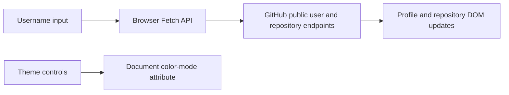

# GitHub User Search

**Look up a GitHub profile from a small browser interface.**

This project demonstrates fetching public API data and turning it into a readable profile view. It is useful for practicing DOM updates, asynchronous requests, conditional display values, and CSS themes without a frontend framework.

[Existing demo link](https://balaji91221.github.io/GitHub-User-Search-App/) · [JavaScript source](script.js)

## What it displays

- Avatar, name, username, biography, and join date.
- Public repository, follower, and following counts.
- Location, website, and Twitter/X username when supplied by the profile.
- Repository cards from the GitHub user-repositories endpoint.
- Light/dark controls that write the selected mode to local storage.

## Architecture



## Run locally

Download and extract the repository. Open `index.html` in a browser, or serve the directory with a simple HTTP server:

```bash
python -m http.server 8000
```

Open `http://localhost:8000`, enter a public username such as `octocat`, and select **Search**. There are no npm dependencies, build steps, or application API keys.

## Repository guide

| File | Purpose |
|---|---|
| [index.html](index.html) | Search and profile layout |
| [style.css](style.css) | Layout and theme styling |
| [script.js](script.js) | Requests, DOM updates, and theme controls |
| `Images/` | Icon assets |

## Current implementation notes

The source needs a request-flow correction: `geturl()` calls `add_repo()`, which calls `geturl()` again, so one search can trigger repeated requests. Add explicit handling for missing users, network errors, and API limits. Repository pagination is not implemented.

Asset paths also need consistent casing: the HTML refers to `images/` and `assets/`, while committed icons are in `Images/`. This matters on case-sensitive hosts. The demo link is retained from existing documentation; availability is not verified here.

## Design and credits

The interface is based on the [Frontend Mentor GitHub user search challenge](https://www.frontendmentor.io/challenges/github-user-search-app-Q09YOgaH6). The project uses GitHub's public API, Google Fonts, and favicon assets acknowledged in the original documentation.

## Contributing

Useful improvements include a single request flow per search, error states, accessible controls, and repository pagination. Include the username and expected UI behavior when reporting a reproducible issue.
